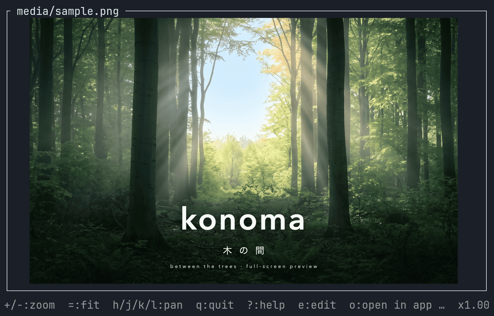
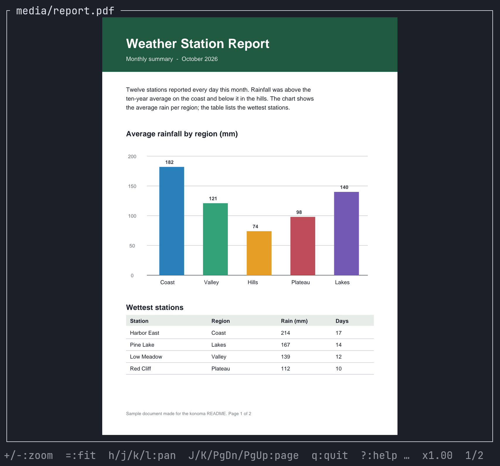

# konoma-media

Full-screen preview of images, SVG, PDF pages and video thumbnails in the terminal.
These are the picture plugins of [konoma](https://github.com/LESIM-Co-Ltd/konoma), a terminal file browser.





| Crate | What it is |
|---|---|
| [`konoma-media`](crates/konoma-media) | The `image`, `svg`, `pdf` and `video` plugins, and a `konoma-media` program that opens one file |
| [`konoma-media-core`](crates/konoma-media-core) | Library that turns a PDF page or a video into an `image::DynamicImage` |

konoma already has these four plugins built in, so using konoma needs nothing from this repository.

## Try it

```sh
cargo install konoma-media
konoma-media picture.png
```

From a clone, with the files in [`samples/`](samples):

```sh
cargo run -p konoma-media -- samples/sample.pdf
```

`samples/` also holds PNG, JPEG, GIF, MP4 (H.264 and HEVC) and MKV files.
See the [`konoma-media` README](crates/konoma-media) for keys, settings and limits.

## Build and test

Rust 1.92 or newer. macOS and Linux are tested in CI.
On Debian or Ubuntu, CI installs `pkg-config cmake libssl-dev zlib1g-dev` first.

```sh
cargo build
cargo test
```

## License

[MIT](LICENSE)
