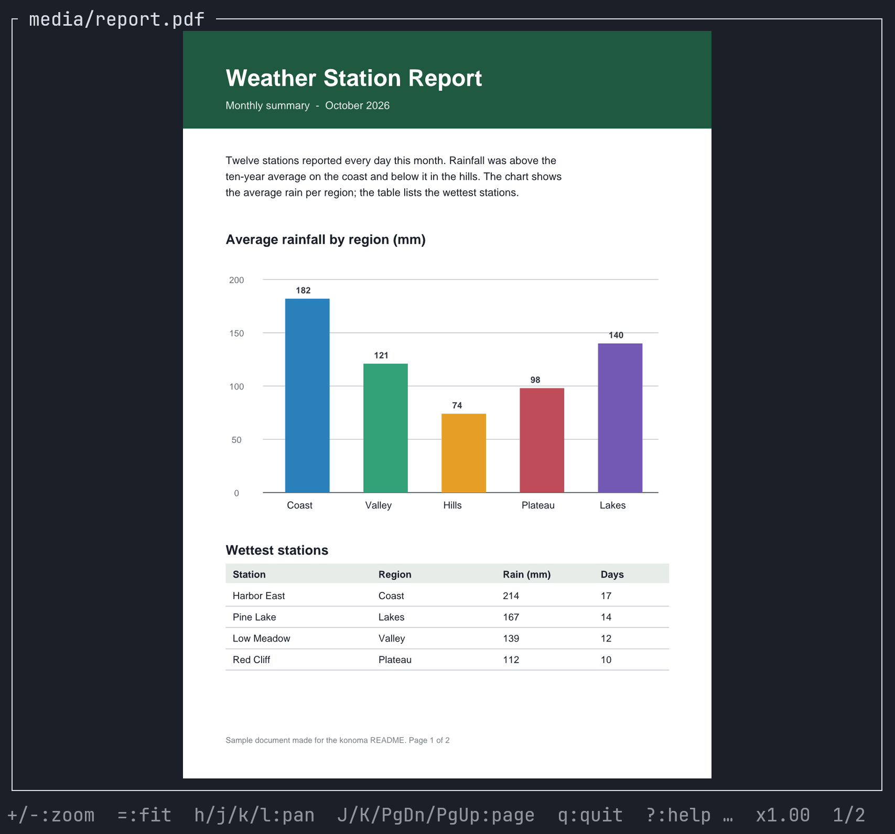

# konoma-media-core

Renders a PDF page, or one frame of a video, to an
[`image::DynamicImage`](https://docs.rs/image/latest/image/enum.DynamicImage.html).
Rendering happens in-process in Rust first; external tools are used only if you allow them.
It is the library under [`konoma-media`](https://github.com/LESIM-Co-Ltd/konoma-media), part of
[konoma](https://github.com/LESIM-Co-Ltd/konoma).



It does not draw to a terminal, play video or audio, extract text from PDFs, accept PDF
passwords, or decode still images.

## Example

With `konoma-media-core = "0.1"` and `image = "0.25"` as dependencies:

```rust
use std::path::Path;

use konoma_media_core::{pdf, video};

fn main() -> Result<(), image::ImageError> {
    let doc = Path::new("samples/sample.pdf");
    let pages = pdf::page_count(doc).unwrap_or(1);
    // `false`: stay in-process. `true` also lets macOS try qlmanage/sips on page 1.
    if let Some(page) = pdf::render_page(doc, 1, false) {
        println!("{pages} pages, page 1 is {}x{}", page.width(), page.height());
        page.save("page1.png")?;
    }

    // `true`: fall back to ffmpegthumbnailer / ffmpeg for what is not decoded here.
    if let Some(frame) = video::thumbnail(Path::new("samples/sample.mp4"), false) {
        println!("thumbnail is {}x{}", frame.width(), frame.height());
        frame.save("thumb.png")?;
    }
    Ok(())
}
```

## API

| Item | Purpose |
|---|---|
| `pdf::render_page(path, page, allow_external)` | Render a page (1-based; 0 is read as 1) |
| `pdf::render_page_bytes(bytes, page)` | Same from memory, in-process only |
| `pdf::page_dimensions_bytes(bytes, page)` | Page size in PDF points |
| `pdf::page_count(path)`, `pdf::page_count_bytes(bytes)` | Number of pages |
| `pdf::PAGE_COUNT_MAX_BYTES` | Size cap of the two page counters (64 MiB) |
| `video::thumbnail(path, allow_external)` | One representative frame |

Failures are `None`; there is no error type that says why.

## PDF

- Rendered with [`hayro`](https://crates.io/crates/hayro). The longest side is scaled to about
  1600 px and the page is composited on white.
- A page on which nothing at all is painted gives `None`.
- Non-embedded CJK fonts are looked up among the system's fonts.
- External fallback (`allow_external`): `qlmanage`, then `sips`, on macOS and for page 1 only.
  Other platforms have none.

## Video

In-process decoding, chosen by file extension:

| | Supported |
|---|---|
| Containers | `.mp4`, `.m4v`, `.mov`, `.mkv`, `.webm` |
| H.264 | Baseline, Main, High; 8-bit 4:2:0 |
| HEVC | Main, Main 10; 4:2:0 |

The frame is taken from a keyframe around 10% into the file, preferring one that is not a flat
colour, and is at most 1024 px on its longest side (the `ffmpeg` fallback limits only the width).

Everything else returns `None` unless `allow_external` is true, in which case
`ffmpegthumbnailer` and then `ffmpeg` are tried (both optional, found on `PATH`).

Decoded frames are meant as thumbnails: they are not guaranteed to be bit-identical to
ffmpeg's.

## Untrusted input

- Panics from the PDF and video parsers and decoders are caught and become `None`. This relies
  on unwinding, so it does not help under `panic = "abort"`.
- In-process video: coded size up to 8192 px per side, 64 MiB per compressed sample; for
  Matroska, a scan of up to 32 MiB or 2000 packets per attempt.
- Page counting refuses input over 64 MiB. **Rendering a PDF page has no file size limit** and
  reads the whole file into memory.
- Each external tool is killed after 30 seconds. In-process work has no time limit.
- Images written by external tools are decoded under limits of 32,768 px per side, 150
  megapixels and 512 MiB.
- Calls block; run them off your UI thread.

## Requirements

Rust 1.92 or newer. macOS and Linux are tested in CI. No feature flags.

## License

[MIT](https://github.com/LESIM-Co-Ltd/konoma-media/blob/main/LICENSE)
