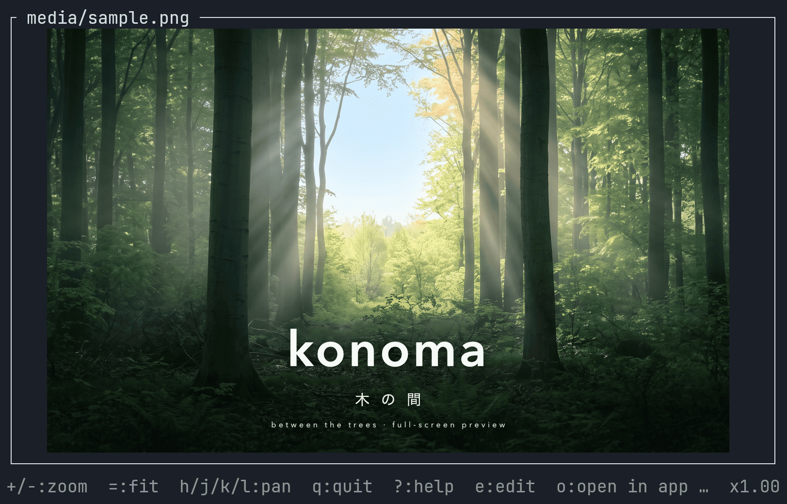
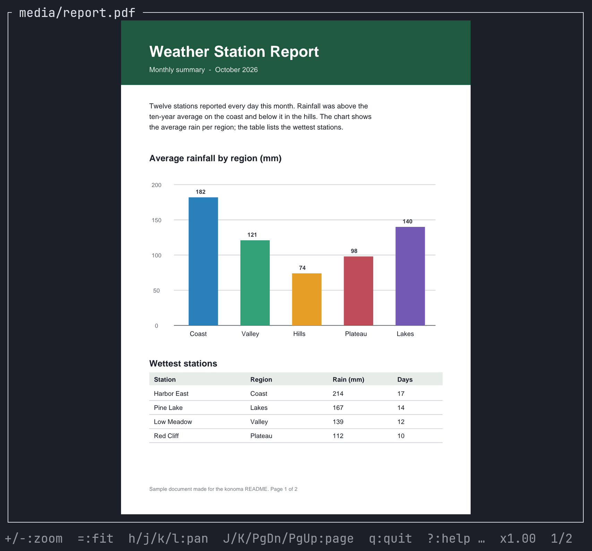

# konoma-media

Shows one image, SVG, PDF or video file full screen in the terminal. The same crate provides the
`image`, `svg`, `pdf` and `video` plugins of [konoma](https://github.com/LESIM-Co-Ltd/konoma).





| Plugin | Takes | Shows |
|---|---|---|
| `image` | Files whose content is an image: PNG, JPEG, GIF, WebP, BMP, TIFF, ICO | The picture; GIFs animate |
| `svg` | `*.svg` | The drawing; if it cannot be drawn, the reason and the source text |
| `pdf` | `*.pdf` | One page at a time |
| `video` | Files whose content is a video | One still frame. Videos are not played |

Images and videos are recognised by content, so a missing or wrong extension does not stop a
file from being taken (see the video limits below).

## In konoma

All four plugins are linked into konoma: select a file and it is previewed. There is nothing to
install, and `konoma plugin install konoma-media` is refused because the crate is already part of
the standard build. In konoma's `config.toml`:

```toml
[plugins.video]
enabled = false      # switch one plugin off

[external]
pdf = true           # macOS only: try qlmanage / sips when page 1 cannot be rendered
video = true         # try ffmpegthumbnailer / ffmpeg for videos not decoded in-process
```

## Standalone program

```sh
cargo install konoma-media
konoma-media photo.jpg
```

| Command | Effect |
|---|---|
| `konoma-media <file>` | Show one file. Standard input and output must be a terminal |
| `konoma-media --help`, `-h` | Usage |
| `konoma-media --version` | Id and version of each of the four plugins |
| `konoma-media --plugin <id> --manifest` | Print what a plugin declares, as JSON |
| `konoma-media --plugin <id> --serve` | Speak konoma's plugin protocol on stdin/stdout |

`<id>` is `image`, `svg`, `pdf` or `video`.

### Keys

| Key | Action |
|---|---|
| `+` `-` | Zoom |
| `=` | Fit to the window |
| `h` `j` `k` `l`, arrows | Pan when zoomed |
| `J` `K`, `PageDown` `PageUp` | Next / previous PDF page |
| `e` | Open the file in an external editor |
| `o` | Open the file in another application |
| `y` then `n` / `r` / `f` / `p` / `@` | Copy the name / relative path / full path / parent / `@` reference |
| `Space` | Action menu |
| `?` | All keys |
| `q`, `Esc`, `Q` | Quit |

### Configuration

The program reads konoma's configuration file, `$XDG_CONFIG_HOME/konoma/config.toml`
(`~/.config/konoma/config.toml` when `XDG_CONFIG_HOME` is not set). It works without one; if the
file cannot be parsed, defaults are used and the error is printed. The interface is in English
or Japanese (`[ui] lang`, or the locale).

```toml
[plugins.svg]
max_px = 1600   # default 800
```

`max_px`: an SVG smaller than this is scaled up until its longest side reaches it. The drawing
is never larger than 4096 px on a side.

## Terminal

Real pixels need a terminal with a graphics protocol (kitty graphics, sixel or iTerm2 inline
images). Elsewhere the picture is approximated with half-block characters.

## Limits

- **The standalone program never runs external tools.** `ffmpeg`, `ffmpegthumbnailer`,
  `qlmanage` and `sips` are used only by a host that enables them, such as konoma. This holds even
  though the video failure message suggests installing ffmpeg.
- Video decoded in-process is H.264 or HEVC in files named `.mp4`, `.m4v`, `.mov`, `.mkv` or
  `.webm`, within the profiles listed in
  [`konoma-media-core`](https://github.com/LESIM-Co-Ltd/konoma-media/tree/main/crates/konoma-media-core).
  In the standalone program, anything else (VP9, AV1, `.avi`, a video without one of those
  extensions) shows no thumbnail.
- No audio or video playback.
- PDFs that need a password are not opened.
- For a PDF over 64 MiB the page count is not read: only page 1 is shown, with no page navigation.
- Images over 32,768 px on a side, 150 megapixels or 512 MiB decoded are refused.
- SVG files over 32 MiB are not drawn.
- AVIF is not decoded.
- Files cannot be edited here; `e` hands them to an editor.

## License

[MIT](https://github.com/LESIM-Co-Ltd/konoma-media/blob/main/LICENSE)
